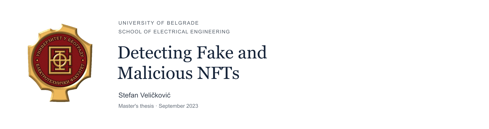

# Artificial Intelligence for Detecting Fake and Malicious NFTs

Research code accompanying a **master's thesis at the University of Belgrade, School of Electrical Engineering**. The study investigates NFT scam detection through three independently evaluated sources of evidence: images, textual descriptions, and collection website domains.

**Author:** Stefan Veličković · **Advisor:** Prof. Dr. Boris Delibašić · **Date:** September 2023

**Publication status:** Thesis in the process of being published.

**Original title:** Примена вештачке интелигенције за препознавање лажних и малициозних NFT-ева

[Research overview](#research-overview) · [Notebooks](#research-notebooks) · [Results](docs/RESULTS.md) · [Reproducibility](docs/REPRODUCIBILITY.md) · [Citation](#citation)

## Research overview

NFT scams can exploit visual presentation, descriptive text, and collection websites. This thesis examines how different machine learning approaches use each of those signals to distinguish examples labeled legitimate from examples labeled scam or malicious.

The work compares classical classifiers, convolutional and recurrent neural networks, transfer learning, and a transformer-based text classifier. The three notebooks are separate experiments; the repository does not implement a trained end-to-end fusion model combining all modalities.

The research provides:

- An image-classification study comparing a custom CNN, ResNet50, VGG16, an LSTM-based network, and a ResNet50/CNN hybrid.
- A description-classification study covering TF-IDF, Word2Vec, classical machine learning, DistilBERT, and a feedforward network.
- A collection-domain study using lexical features, TF-IDF, tree-based methods, class-imbalance techniques, and recurrent models.
- Preserved notebook outputs documenting the original exploratory work, alongside a guide to the reported results and reproduction constraints.

## Research notebooks

| Study | Notebook | Main approaches |
| --- | --- | --- |
| NFT images | [Images_NFTs_Master.ipynb](Images_NFTs_Master.ipynb) | CNN, ResNet50, VGG16, bidirectional LSTM, hybrid network |
| NFT descriptions | [Metadata_NFTs_Master.ipynb](Metadata_NFTs_Master.ipynb) | TF-IDF, Word2Vec, classical classifiers, DistilBERT, FNN |
| Collection domains | [Domains_NFT_Master.ipynb](Domains_NFT_Master.ipynb) | Lexical features, TF-IDF, Random Forest, SMOTE, LightGBM, XGBoost, recurrent networks |

The notebooks retain their original filenames and saved experiment outputs. The code has received a documented maintenance pass; **saved outputs predate those edits and have not been regenerated**. See [code cleanup and verification](docs/CODE_CLEANUP.md) for changes, offline checks, and the original source revision.

## Reported findings

The thesis reports the following highest accuracies within each study:

| Input modality | Highest-accuracy model reported in the thesis | Accuracy | Thesis reference |
| --- | --- | ---: | --- |
| Images | Custom CNN | 98.36% | Table 4, printed page 57 |
| Descriptions | Random Forest | 94.83% | Table 5, printed page 59 |
| Collection domains | XGBoost | 84.32% | Table 6, printed page 61 |

These figures are **reported thesis results**, not new measurements or independently reproduced benchmarks. Some saved notebook outputs differ from the thesis tables, and the modalities use different datasets and evaluation setups. [Results and provenance](docs/RESULTS.md) records those distinctions; the percentages should not be treated as a controlled comparison of modalities.

## Data and experimental scope

The thesis describes data collection from Phantom's blocklists, NFT marketplaces, and a Kaggle collection dataset. **The original datasets are no longer available**, so the historical experiments cannot be reproduced from this repository. Acquisition scripts, immutable split manifests, and trained checkpoints are also absent.

Labels are derived from the collection and blocklist sources used for the study. They are research labels, rather than independent guarantees about a token, creator, or collection. NFT images and third-party metadata remain subject to their respective owners' rights.

See [Data documentation](docs/DATA.md) for expected inputs, manuscript counts, notebook counts, and known gaps.

## Reading and reproducing the work

For a first review, open the notebooks directly on GitHub and inspect their historical outputs. Future experiments require independently supplied data in the [documented layout](docs/DATA.md); set `NFT_DATA_ROOT` to its location before running. Results on replacement data would be new experiments, separate from the thesis measurements.

A complete historical dependency lock was not captured. The notebooks use legacy Keras preprocessing APIs and several scientific Python frameworks; installing the latest versions of every package is not a verified reproduction procedure. [The reproduction guide](docs/REPRODUCIBILITY.md) explains the limits and requirements for future execution.

Lightweight repository checks can be run without downloading datasets or training models:

```sh
python -m venv .venv
source .venv/bin/activate
python -m pip install -r requirements-test.txt
python scripts/validate_repository.py
python -m unittest discover -s tests -v
cffconvert --validate
```

On Windows, activate the environment with `.venv\Scripts\activate`. These checks validate notebook syntax, historical-output preservation, documentation, citations, and selected code paths on synthetic inputs. They do not train models or reproduce research scores. Optional framework tests skip when TensorFlow/Pillow is absent.

## Limitations and further research

The study is limited by the number and provenance of scam examples, class imbalance, incomplete metadata, and the changing nature of NFT scams. Stronger follow-up evaluation should include collection-disjoint and time-based splits, duplicate control, training-only feature fitting, probability-based ROC-AUC, repeated trials, and uncertainty estimates. These are directions for further validation, not experiments claimed to have been completed here.

[Research notes](docs/RESEARCH_NOTES.md) separates limitations documented in the thesis from observations about the archived notebooks.

## From thesis to application

This thesis research provided the basis for **[MintEye](https://github.com/stefisha/MintEye)**, a later Solana Radar Hackathon application for NFT risk classification. The thesis repository preserves the research experiments; MintEye contains the subsequent application and inference workflow. Its models and runtime should not be treated as the exact thesis evaluation artifacts.

## Citation

For the thesis:

> Veličković, S. (2023). *Примена вештачке интелигенције за препознавање лажних и малициозних NFT-ева* [Unpublished master's thesis, University of Belgrade, School of Electrical Engineering].

The English heading above is a descriptive translation. No DOI or publication venue is asserted. Use [CITATION.cff](CITATION.cff) for machine-readable citation metadata, or [citation.bib](citation.bib) for BibTeX. The full thesis manuscript is not redistributed in this repository.

## Repository contents

```text
Images_NFTs_Master.ipynb     Image experiments and saved outputs
Metadata_NFTs_Master.ipynb   Description experiments and saved outputs
Domains_NFT_Master.ipynb    Domain experiments and saved outputs
docs/                      Data, results, methods, and reproduction notes
assets/                    Repository presentation assets
scripts/                   Notebook syntax and repository validation
tests/                     Offline synthetic regression checks
CITATION.cff               Machine-readable research citation
citation.bib               BibTeX thesis citation
LICENSE                    MIT license for repository code
```

## License

The repository code is available under the [MIT License](LICENSE). This does not grant rights to third-party NFT artwork, source datasets, or the separately supplied thesis manuscript.
